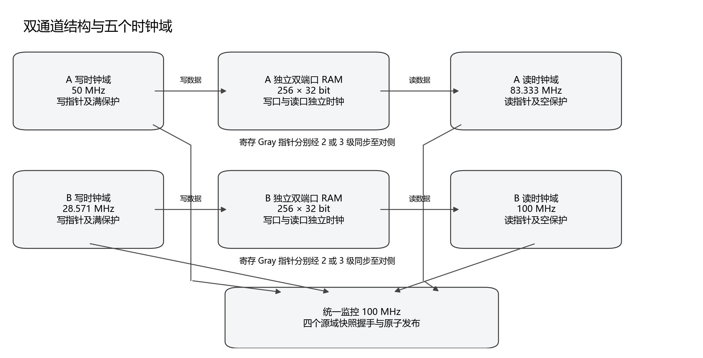
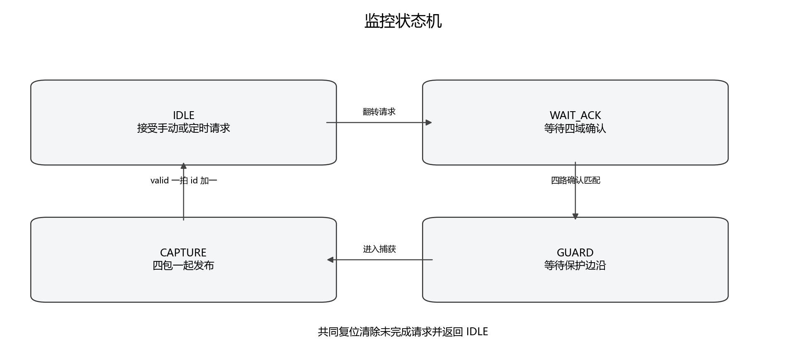
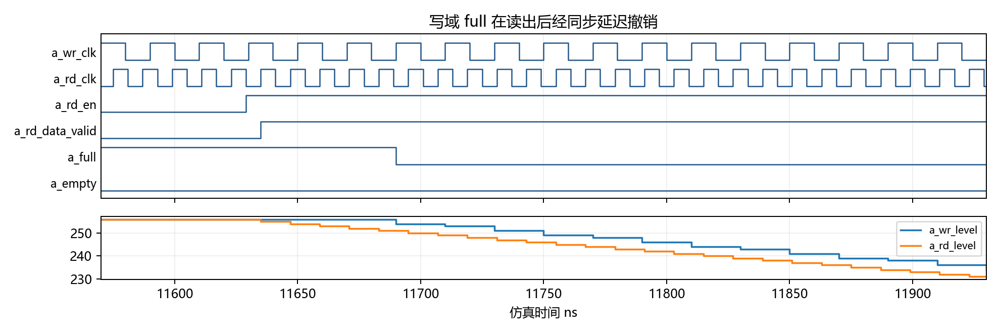
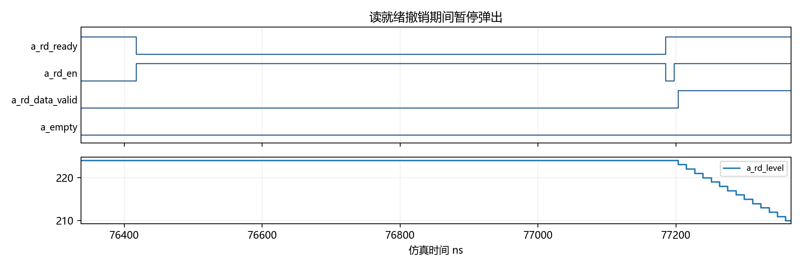
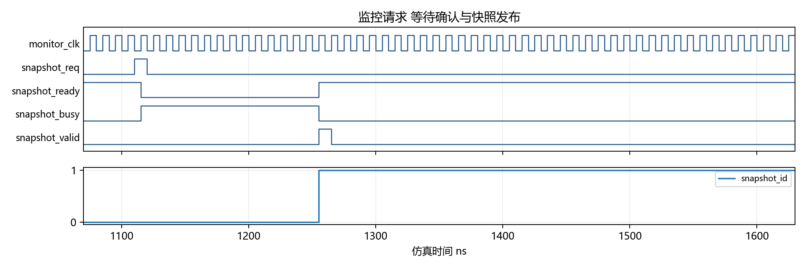

# 双异步 FIFO 系统设计与验证

## 1 设计题目与目的

本课设选择题目1双异步 FIFO 系统，在两个独立通道上实现跨时钟域缓冲、空满保护、阈值预警、读侧背压、错误统计及统一监控。每路存储容量为256×32 bit，RTL 使用 Verilog 描述，验证使用 SystemVerilog 和 C++。

设计目的包括理解二进制与格雷码指针的配合、建立可复现的数据完整性检查，并通过两级和三级同步器的对比分析延迟、资源与可靠性的取舍。时钟比例按题目设置，绝对频率作为实验条件明确记录。

两路核心、统一监控和六类指定场景已实现。单通道9组、双通道10组回归通过；原生功能目标合并命中63/63，六组延迟和吞吐测量通过。后文分别呈现 RTL 行为结果、目标器件资源与时序结果，避免将仿真速率当作物理最高频率。

实验以软件设计、仿真、综合和实现分析为范围。任务书总体要求和题目1未要求实物上板。PH1A100SFG676是根据本机可用工具选择的软件评估目标，并非任务书指定器件。

| 项目 | 规格或实验约定 |
| --- | --- |
| FIFO 数量与规模 | 2路，每路256项，每项32 bit |
| A 路读写频率比 | 5:3，参考周期为写20 ns、读12 ns |
| B 路读写频率比 | 7:2，参考周期为写35 ns、读10 ns |
| 监控时钟 | 参考周期10 ns，独立于四个数据时钟 |
| 阈值默认值 | almost_full=224，almost_empty=32，可配置回差 |
| 同步与复位 | Gray 同步级数2或3；共同异步复位，各域两级同步释放 |

## 2 模块结构与接口



顶层 dual_async_fifo 实例化 fifo_a、fifo_b 与 fifo_monitor。两路复用同一参数化 async_fifo 代码，但各自拥有独立 RAM、读写指针、状态和统计。监控从四个源域获取保持的快照，业务读写不等待监控。

默认端口宽度和所属时钟域见文末接口附录；完整参数及逐字段定义另见docs/INTERFACE.md和docs/MONITOR_PROTOCOL.md。

| 模块 | 主要职责 |
| --- | --- |
| reset_sync | 共同复位的异步断言与本地域同步释放 |
| gray_sync | 参数化多级同步寄存器链 |
| fifo_ram | 行为描述的双时钟 RAM 与注册读输出 |
| async_fifo | 指针、保护、阈值、背压和六类计数 |
| snapshot_mailbox | 源域捕获与保持、请求确认同步 |
| fifo_monitor | 四域确认等待、保护窗口和统一发布 |

## 3 时钟域 复位与设计假设

系统存在五个时钟域。A、B 通道的写域产生写指针，读域产生读指针；寄存的 Gray 指针通过对侧同步链进入目标域，再转换为二进制用于本地水位估计。不得直接逐位同步会同时改变多位的二进制指针。

共同 rst_n 断言时立即清空指针、输出有效及统计，各时钟域分别经过两级复位同步器释放。复位清空 FIFO 中尚未读出的数据，验证模型将其计入 reset_discarded。单侧独立复位不属于本接口协议，不能据共同复位测试推断其安全性。

接口采用请求式读响应：在读时钟上升沿，只有 rd_en、rd_ready 和非空同时满足，且本地域已退出复位，才接受一次读操作；RAM 输出在该边沿更新，rd_data_valid指示本拍是否接受。未接受时保持 rd_data，不要求 RAM 数组复位。

| 假设 | 对实现及验证的影响 |
| --- | --- |
| 各时钟可有任意初始相位 | 测试包含多种相位；源指针使用寄存输出 |
| 各域同步释放后才发起有效请求 | 使用 wr_rst_done、rd_rst_done 对接受操作门控 |
| 监控需要所有源时钟推进 | 某源停钟时允许 busy 保持，恢复后继续完成 |
| 水位是本地域估计 | 远端指针同步滞后，估计不等同全局瞬时占用 |
| 源 Gray 每次最多前进一个码值 | 只对源指针检查一位变化，不对同步后跳码作同一限制 |
| 快照来自同一请求的不同捕获时刻 | 不将四域快照表述为全局同一瞬间 |

## 4 FIFO 指针与保护算法

深度256需要8位 RAM 地址和9位环形位置。二进制指针用于加法和寻址，最高位区分同一地址的不同绕回轮次；格雷码用于跨域。写侧根据本拍实际接受情况计算下一写指针，再注册 full；读侧对下一读指针作相同处理并注册 empty。

gray = binary XOR (binary >> 1)

空判断比较下一读 Gray 与已同步的写 Gray。满判断比较下一写 Gray 与已同步读 Gray 的最高两位翻转值。满时写使能被忽略，不写 RAM、不移动写指针，也不增加成功写计数；空时不弹出数据。

```text
wr_fire = wr_rst_done AND wr_en AND NOT full
rd_fire = rd_rst_done AND rd_en AND rd_ready AND NOT empty
wbin_next = wbin + wr_fire
rbin_next = rbin + rd_fire
wgray_next = wbin_next XOR (wbin_next >> 1)
rgray_next = rbin_next XOR (rbin_next >> 1)
full_next = (wgray_next == inverted_top_two_bits(rgray_sync))
empty_next = (rgray_next == wgray_sync)
if wr_fire: RAM[wbin.address] <- wr_data
if rd_fire: rd_data <- RAM[rbin.address]
```

RAM 行为描述分别使用写时钟和读时钟，不调用设计 IP。目标综合工具将数组推断为两块独立 ERAM，属于 RTL 的存储映射；设计源码仍保持通用 Verilog。检查器维护独立二进制位置与参考队列，不复用 Gray 满比较表达式作为唯一判断依据。

## 5 阈值 背压与统计

写域用下一写位置减去同步读位置，读域用同步写位置减去下一读位置，均以9位模运算得到本地水位。默认几乎满在水位达到224时置位，几乎空在水位降至32时置位；回差测试将撤销阈值分别设置为220和36，以验证阈值附近保持行为。

rd_ready=0时禁止弹出并保持读指针和读输出。背压事件定义为 rd_en有效、FIFO非空且ready为低的连续停顿段；每段开始计一次事件，每个停顿读周期另计一次周期。空时的有效读尝试归入下溢统计，不作为背压。

| 计数器 | 增加条件 |
| --- | --- |
| write_count | 写请求被实际接受 |
| read_count | 读请求被实际接受 |
| overflow_count | 已退出写域复位，wr_en=1且full=1 |
| underflow_count | 已退出读域复位，rd_en=1、ready=1且empty=1 |
| backpressure_count | 停顿条件从不成立变为成立 |
| backpressure_cycles | 每个满足停顿条件的读周期 |

计数器默认32位，达到最大值后饱和保持。验证使用额外4位配置加速进入饱和区间，检查成功读写、非法尝试和背压统计。复位清零所有计数器。水位峰值不是本次已实现的统计项，不将其列为完成的拓展功能。

## 6 统一监控与快照协议



监控域空闲时接受请求并翻转 request_toggle。每个 mailbox 在自己的源时钟域看到同步请求变化后，锁存整个状态包并更新确认。源包在下一次请求前保持，监控等待四路确认匹配，再经过 GUARD 和 CAPTURE 两个后续边沿后统一发布。

| 包 | 默认宽度 | 从高位到低位的字段 |
| --- | --- | --- |
| 写状态包 | 75 bit | almost_full、full、wr_level、overflow_count、write_count |
| 读状态包 | 139 bit | almost_empty、empty、rd_level、backpressure_cycles、backpressure_count、underflow_count、read_count |

统一发布时四个包一起更新，snapshot_valid仅保持一个监控周期，snapshot_id加一。busy时请求不排队；共同复位取消未完成事务。AUTO_REFRESH_CYCLES=0为手动模式，非零时在空闲期间按设定周期发起刷新；实际刷新间隔还包含握手完成时间。

保持总线方案依赖真实实现中的数据到达时间，因此约束中对四条 held_data总线施加一个监控周期的最大数据路径限制，并单独核对这些限制没有被跨域假路径覆盖。

## 7 验证平台与指定场景

每路独立参考队列只根据实际接受操作入队和出队。写、读位置模型各自维护对侧位置的延迟副本，以核对注册标志和水位；采样延后1 ps避开非阻塞赋值更新。另一个检查器在源确认变化时记录外部状态包，再逐次比较监控发布，检查器不直接把 DUT 内部状态包当作预期值。

| 任务书用例 | 执行内容 | 主要核对 |
| --- | --- | --- |
| 6.1 写满读空 | 两路各三轮装满256项并排空 | 容量、顺序、绕回与空满 |
| 6.2 随机混合 | 每路5000次随机写侧决策，读侧独立决策 | 写多读少、均衡、写少读多 |
| 6.3 保护与错误 | 满后写、空后读各额外20次 | 指针与数据保持、错误增量 |
| 6.4 阈值穿越 | 覆盖31/32/33及223/224/225等边界 | 标志上升下降、可选回差 |
| 6.5 背压 | 随机就绪变化及1拍、4拍、64拍定向停顿 | 数据完整、暂停恢复与统计 |
| 6.6 双路组合 | A满B空、B满A空、同时几乎满及同时停顿 | 通道独立与监控一致 |

“5000次”精确定义为每路5000个写时钟上的随机决策，读侧同时独立运行，并不表示每次请求都被接受。随机阶段按85/50/20%的写概率与20/50/90%的读概率切换，ready有效概率为75%，以产生不同流量状态。

所有运行有超时和失败判定。收尾停止写入、解除背压，等待最终指针传播并排空，核对累计写入=累计读出+复位丢弃。原始日志保存固定种子、参数、相位和结果，单独选择用例和快速自检属于后续便利性完善。

## 8 验证结果与覆盖率

| 验证集合 | 实测结果 |
| --- | --- |
| 单通道回归 | 9组通过 |
| 双通道及监控回归 | 10组通过，共9763649次过程式检查、10290次快照 |
| 原生覆盖率回放 | 2组通过，C++独立队列检查1121147次通过 |
| 功能目标并集 | 63/63，100% |
| 断言激活 | 17/17，断言失败0 |
| RTL line插桩点 | 45/47，95.745% |
| RTL branch插桩点 | 59/64，92.188% |
| 评估封装附加验证 | 两种同步级数通过原有完整自检及状态选择检查 |

本机 ModelSim Starter的covergroup加载受许可证限制；额外 Verilator 二进制也会忽略 covergroup，因此改用实际支持的 cover property，开启原生功能点、line/branch插桩和SVA。原始.dat数据库随仓库保留，汇总程序只读取工具记录，不将旧的过程式计数改称原生覆盖率。

手动配置功能点为62/62；自动配置为61/63，其中手动模式专用的停钟等待、复位取消由手动配置命中，合并并集为63/63。断言激活由单独的cover property记录检查条件实际出现，不等同形式证明或工具自动断言覆盖率。

未命中代码点包括合法配置下不会执行的参数错误终止、两位监控状态已覆盖全部四种取值后剩余的default分支，以及不同参数展开下恒真或恒假的自动刷新条件。所有分母保留，逐点解释见 reports/native_coverage/POINTS.md。

负向检查分别在临时副本翻转RAM读数据或监控状态位，均能被检查器拒绝；原生回放还将首个预期读字翻转一位，得到exit=1的数据失配。正式RTL没有保留这些注错。

## 9 关键仿真波形



波形来自种子1、两级同步、手动监控配置的通过运行。A路首次full撤销发生在11690 ns附近：读侧已经弹出数据后，写侧需要等待同步链和标志寄存更新，full才撤销。wr_level和rd_level属于不同域，不要求每一瞬间相等。



76417 ns附近撤销ready后，读请求持续存在而rd_data_valid保持低，读域水位稳定；解除背压后继续读出。数据内容、顺序和输出保持由队列检查器逐次核对，波形只展示选定窗口。

## 10 监控发布波形与复现条件



请求被接受后snapshot_ready撤销、busy置位；等待四个源域确认和保护窗口后，snapshot_valid产生单周期脉冲，snapshot_id递增。连续发布之间输出包保持稳定，各域数据对应同一请求但捕获时刻不同。

| 项目 | 记录 |
| --- | --- |
| 仿真器 | ModelSim ALTERA Starter Edition 10.3c |
| 原生覆盖率工具 | verilator包5.48.0；实际二进制rev vUNKNOWN-built20260516-4e853d8 |
| C++编译 | Zig 0.14.1 |
| 通用综合 | Yosys 0.70，Git 28ba3cb92，YoWASP封装 |
| 目标实现 | Tang Dynasty V6.2.168116，PH1A100SFG676，速度等级2 |
| 构建目录 | 使用英文路径；工具产物与大波形位于仓库外 |
| 结果溯源 | 各报告目录保留日志、参数及规范化源码SHA256 |

代码、原生数据库、原始日志和报告保存在同一个Git仓库。此前功能验证的来源以其各自manifest为准，本阶段新增的评估封装、约束、波形和报告另记来源，不用新提交号替换旧实验的真实基线。

## 11 软件实现目标与约束

采用已安装的TD工具和PH1A100SFG676速度等级2作软件评估，固定同一器件、线程数、布局种子及优化设置，对SYNC_STAGES=2和3分别实现。保留层次，关闭移位寄存器推断、寄存器合并与顺序优化，并检查原有ASYNC_REG属性。

原始顶层共有1038位端口，超过该封装的316个用户IO。评估封装保留数据、标志、水位和复位完成端口，将统计与快照的844位状态通过只读32位选择输出保留可观察性，顶层IO降至231。封装没有新增时序反馈，资源统计包含该组合选择逻辑与IO。

| 约束对象 | 约束及检查 |
| --- | --- |
| 五个独立时钟 | 20/12/35/10/10 ns；显式不确定度0.2 ns，工具还计入器件默认不确定度 |
| 四条9位Gray总线 | 逐位最大数据延迟不超过源周期，以此作保守偏斜上界；只排除异步hold关系 |
| 四个mailbox请求及确认 | 共8条单bit跨域路径，最大数据延迟10 ns |
| 四条保持总线 | 75/139/75/139 bit，各自最大数据延迟10 ns |
| 普通外部数据接口 | 完整接口视图采用最小0.5 ns、最大为对应周期20%的预算 |
| 诊断选择输出与共同复位输入 | 显式列出例外；不用于宣称外部接口时序通过 |

TD的read_sdc不执行任意Tcl循环，约束生成器因此输出纯静态SDC，端点审计使用独立Tcl。工具报告核对五个命名时钟和16组跨域数据路径，不能以默认DeriveClock或仅存在约束文件作为生效证据。

16组最大延迟约束覆盖472条路径，报告中Dominated等于Total，Shadowed和Ignored均为零。四条Gray总线每组均报告9位路径，两种级数各总线的最大数据路径在0.929至1.203 ns之间，均低于相应源周期。额外set_max_skew命令没有独立的生效报告，因此不宣称该命令已经完成独立偏斜签核。

分别保留完整接口预算视图和内部寄存器路径报告。后者在同一套SDC下筛选内部寄存器起止路径，不额外添加假路径或更改时钟；它用于分析核心逻辑，不能据此宣称外部接口已收敛。每组保存最差20个端点的报告。

## 12 资源与时序实测

| 指标 | 2级同步 | 3级同步 |
| --- | --- | --- |
| TD目标实现寄存器位 | 1532 | 1576 |
| 目标实现LUT6 | 1040 | 1040 |
| ERAM20K数量 | 2 | 2 |
| 顶层IO位 | 231 | 231 |
| 完整接口setup WNS ns | -5.919 | -5.919 |
| 完整接口hold WNS ns | -2.794 | -2.794 |
| 内部视图setup WNS ns | 0.387 | 0.924 |
| 内部视图hold WNS ns | 0.021 | 0.02 |

两块RAM各存储8192个有效数据位，分别映射为一块ERAM20K，合计有效数据16384 bit。ERAM宏的物理容量与有效存储位数不同。LUT6、寄存器及RAM块数为目标资源口径，不换算成平方微米物理面积。

按TD层次资源归属，核心占用LUT6为799/812，只读评估封装及边界占用为241/228。层次间优化会改变归属，主要比较口径仍为整个评估顶层。

| 时钟域 | 2级内部Fmax MHz | 3级内部Fmax MHz |
| --- | --- | --- |
| a_wr_clk | 131.718 | 172.176 |
| a_rd_clk | 211.149 | 190.114 |
| b_wr_clk | 173.31 | 159.821 |
| b_rd_clk | 173.31 | 189.609 |
| monitor_clk | 104.026 | 110.181 |

完整接口预算视图未收敛，最差setup路径包含RAM到外部数据输出，最差hold路径包含外部写数据到RAM；这些路径受IO缓冲、自动引脚放置和外部预算影响。内部视图的Fmax只反映其定义下的内部路径，应与接口视图及hold结果一起阅读。

## 13 PPA 对比与分析边界

| 维度 | 本次结果及解释 |
| --- | --- |
| P 功耗 | 未获得有效W值。TD提示PWR-5001 Import power lib first，本机未找到对应厂商功耗库。 |
| P 性能 | 已记录两种时序视图、五域关键路径和Fmax；完整接口预算存在违例。 |
| A 资源面积 | 以同器件LUT6、寄存器、ERAM及IO资源报告面积代理，不冒充硅面积。 |
| 延迟与吞吐 | 六组RTL行为测量独立列出，不作为达到物理频率的证明。 |

原生功耗接口已能建立设计功耗图，但没有单元功耗库时不能执行有效计算。导出的空计数或零值不表示芯片功耗为零，本报告不将其填入PPA数值对比。后续得到匹配本器件的库后，需在两种级数下使用同一电压、结温、活动及分析阶段再计算。

仅对同步链的时钟负载作结构性比较：四条9位指针同步链和8条单bit监控同步链，共44 bit，每增加一级会多44个同步寄存器；从2级到3级，同步寄存器数量从88增至132，在等效单位时钟负载的假设下，该部分增加50%。这一比例不代表整个FIFO功耗增加50%，也不能换算为W。

诊断选择封装被计入目标资源和潜在功耗，核心内部时序视图则排除了其异步外部路径。使用不同顶层封装、引脚位置、IO标准或优化配置会改变实现结果，因此对比只在本报告给定条件内成立。

TD另给出TMR-5506关键警告：ERAM地址或片选来自异步复位寄存器，存在RAM数据异常翻转的潜在风险。当前协议在共同复位时丢弃旧内容并对有效操作门控，但尚未完成这一器件物理行为的门级或厂商规则验证。因此本报告保留该警告，不作可直接部署硬件的结论。

通用Yosys结果单独保留：保留抽象RAM时外部寄存器为1530/1574位，两种级数均为两块256×32 RAM；全部展开为FF后分别为17974/18018位。两种工具的优化和RAM吸收读寄存器口径不同，不直接混加这些数字。

## 14 同步级数与 MTBF 分析

采用公开同步器模型解释可靠性：平均失效间隔随可用稳定时间呈指数增长，并与目标时钟频率及异步翻转率有关。C和τ依赖具体器件及工作条件。该关系用于说明同步级数的取舍，RTL零失配不能代替亚稳态失效率测量。[2][3]

MTBF ≈ exp(Tres / τ) / (C · fclk · ftoggle)

MTBF3 / MTBF2 ≈ exp(ΔTres / τ)

在布线和单元开销相近的假设下，增加一级同步可提供接近一个目标域周期的额外稳定时间；实际还需扣除单元、布线、setup及不确定度等开销。四个指针同步方向的参考目标周期分别为20、12、35、10 ns，不能给所有同步链套用同一个周期。


本机资料未提供PH1A100同步器校准用C和τ，因此不填写绝对MTBF年数，也不把其他厂商的器件参数套入本器件。模型仅说明额外稳定时间的指数收益；系统总失效率还需汇总多个跨域同步链，不能用一条链的MTBF代替整个系统。

实测代价与模型分析分别记录：通用综合多44位寄存器，首项读接受增加一个读时钟周期，full撤销增加一个写时钟周期；额外等待使短突发和空满频繁切换时更容易停顿。

## 15 延迟与吞吐对比

| 场景 | 同步级数 | A 路Mbit/s | B 路Mbit/s |
| --- | --- | --- | --- |
| 正常比 | 2 | 1600.00 | 914.24 |
| 正常比 | 3 | 1600.00 | 914.24 |
| ready仅开放20% | 2 | 533.12 | 640.00 |
| ready仅开放20% | 3 | 533.12 | 640.00 |
| 额外读慢写快 | 2 | 695.52 | 640.00 |
| 额外读慢写快 | 3 | 695.52 | 640.00 |

速率按预热后200 μs内成功读出的完整32位字计算，单位为十进制Mbit/s。正常比的A写/读周期为20/12 ns，B为35/10 ns，受写侧供数限制；背压场景每10个读周期仅2个开放，受可用读带宽限制。

| 测量 | 2级 A/B ns | 3级 A/B ns |
| --- | --- | --- |
| 正常比首项写接受到读接受 | 44 / 32.5 | 56 / 42.5 |
| 正常比读出一项到full撤销 | 48 / 77.5 | 68 / 112.5 |
| 额外比首项写接受到读接受 | 148 / 160 | 194 / 210 |
| 额外比读出一项到full撤销 | 26 / 30 | 36 / 44 |

额外场景的A写/读周期为10/46 ns、B为14/50 ns，使读侧成为瓶颈。两种同步级数在足够长的连续窗口内吞吐接近，但首次可读和满撤销的等待不同。窗口完整字取整也会使实测速率略低于理想值。

背压窗口A停顿13335/16667个读边沿，约80.01%；B停顿16000/20000，80%。统计口径和实际接受数由独立检查器核对。所有表格都是给定相位的行为测量，不是任意相位延迟上下界。

## 16 结果分析与总结

双通道设计完成了独立存储、保护、阈值、背压与统计，监控通过源域保持和确认协议统一发布。定向、随机、多相位及复位检查共同验证了数据顺序和控制规则；负向注错确认了检查器能够检测真实失配。

两级与三级同步器均通过功能验证。三级增加稳定时间并付出额外寄存器和指针传播延迟；长窗口稳态吞吐主要由较慢一侧和ready可用比例决定。可靠性提升应依据器件模型和实际稳定时间解释，不能用RTL仿真的正确结果替代MTBF分析。

目标实现识别了两块独立ERAM，并生成两种时序视图。完整接口视图暴露了IO相关违例，说明RTL参考激励与实际可实现接口频率需要分开讨论。功耗缺少厂商模型，PPA表保留真实缺项，不作零功耗或物理签核结论。

后续交付需要由小组成员复核关键算法、波形与报告，填写真实成员信息和分工，并在另一个干净环境按手册复现。当前自动运行结果不代表这些人工环节已经发生。

本阶段已在同一台计算机的新建英文目录复制当前源码，重新编译并运行指定三级配置和完整10组回归，均通过。复制前后源码哈希一致，日志保存在reports/reproduction。该结果验证脚本可从干净目录运行，尚不等同另一位成员在独立环境人工复现。

### 软件复现顺序

```text
powershell -File sim/run_dual.ps1
powershell -File sim/regress_dual.ps1
python tools/run_native_coverage.py
python tools/report_native_coverage.py
python tools/run_synthesis.py
python tools/run_performance.py
python tools/verify_eval_wrapper.py
python tools/run_td.py
python tools/summarize_td.py
python tools/probe_power.py
python tools/reproduce_clean.py
python tools/report_figures.py
python tools/build_course_report.py
```

工具安装路径、英文构建目录及参数覆盖方法见docs/ANALYSIS.md与docs/TARGET_ANALYSIS.md。完整原生日志和数据库保留在reports中；第三方工具二进制、大网表和大波形不提交仓库。

## 17 参考资料与 AI 辅助记录

[1] 硬件描述语言 课设题目27 课程设计任务书 第2至4页 用户提供。

[2] Texas Instruments. Metastability Performance of Clocked FIFOs. SCZA004A, 1996. https://www.ti.com/lit/an/scza004a/scza004a.pdf

[3] Ran Ginosar. Metastability and Synchronizers A Tutorial. IEEE Design and Test, 2011. https://webee.technion.ac.il/~ran/papers/MetastabilitySynchronizersTutorialIEEEDT2011.pdf

[4] 上海安路信息科技股份有限公司. SWUG105 TCL Command User Guide, 2024年11月；SWUG200 Timing Constraints User Guide；SWUG201 Timing Tools User Guide。随TD6.2.1安装包提供。https://www.anlogic.com/support/tools-downloads

[5] Verilator. Coverage Analysis. https://verilator.org/guide/latest/simulating.html#coverage-analysis

[6] 本项目源代码、原始实验日志与版本记录。https://github.com/browerbayersong/Dual-Port-Asynchronized-FIFO-RAM

### AI 使用记录

本项目使用AI协助规格拆分、RTL、参考模型、运行脚本、分析和文档整理。实际提示词包括“我们要做第一个题目，分析分析该怎么做”“列个任务清单和操作手册上传至此仓库”“做吧”“未指定，先做通用综合”，以及后续核对上板范围的提问。详细阶段记录保存在docs/AI_ASSISTANCE.md。

采用输出经过自动编译、队列检查、多配置回归、覆盖率、综合和时序工具运行核对。遇到工具忽略覆盖率、约束循环未执行、功耗库缺失等问题时，保留证据并调整方法。人工复核和教师验收情况由成员按实际完成情况填写。

## 18 关键接口附录

下表为原始dual_async_fifo顶层的默认位宽。每路端口分别带a_或b_前缀，共享端口不带通道前缀。评估封装只重排统计的可观察输出，不改变业务接受规则。

| 端口或字段 | 位宽 | 所属域 | 用途 |
| --- | --- | --- | --- |
| rst_n | 1 | 共同复位 | 低有效；各域同步释放 |
| wr_clk / rd_clk | 各1 | 各路读写 | 独立上升沿时钟 |
| wr_en / wr_data | 1 / 32 | 写域 | 写请求及对应数据 |
| rd_en / rd_ready | 各1 | 读域 | 读请求及响应接收能力 |
| rd_data / rd_data_valid | 32 / 1 | 读域 | 读响应及单拍有效 |
| full / almost_full / wr_level | 1/1/9 | 写域 | 满保护、预警及估计水位 |
| empty / almost_empty / rd_level | 1/1/9 | 读域 | 空保护、预警及估计水位 |
| wr_rst_done / rd_rst_done | 各1 | 对应域 | 本地复位释放完成 |
| write_count / overflow_count | 各32 | 写域 | 成功写入与满时写尝试 |
| read_count / underflow_count | 各32 | 读域 | 成功读出与空时有效读尝试 |
| backpressure_count / backpressure_cycles | 各32 | 读域 | 停顿事件与停顿周期 |
| monitor_clk | 1 | 监控域 | 共享监控时钟 |
| snapshot_req / ready / busy / valid | 各1 | 监控域 | 完整名称均带snapshot_前缀 |
| snapshot_id | 32 | 监控域 | 每次统一发布递增 |
| a_write_status / b_write_status | 各75 | 监控域 | 两路写状态包 |
| a_read_status / b_read_status | 各139 | 监控域 | 两路读状态包 |

包字段布局和有效条件见第6节。原始顶层共1038位端口；软件评估用dual_fifo_eval增加5位status_select和32位status_data，后者为只读异步诊断组合输出，不作为新的跨域数据接收协议。

## 19 成员信息与实际分工

| 姓名 | 学号 | 实际完成工作 | 交叉复核 |
| --- | --- | --- | --- |
|  |  |  |  |
|  |  |  |  |
|  |  |  |  |
