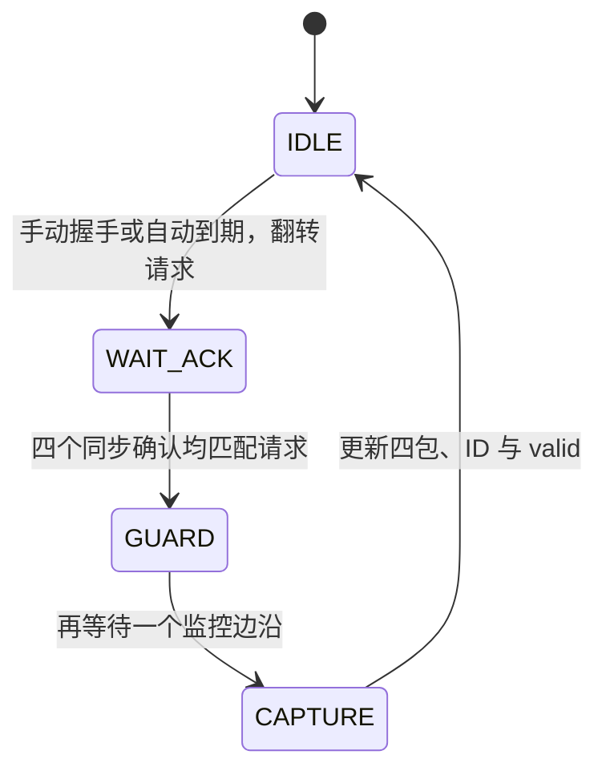

# 统一监控接口与快照协议

监控由四个 source mailbox 和一个 monitor_clk 域控制器组成。源域分别是 A 写、A 读、B 写、B 读。业务计数始终在各自时钟域更新，监控不会冻结或推进 FIFO 业务指针。

## 请求与发布

| 端口 | 所属域 | 含义 |
| --- | --- | --- |
| snapshot_req | monitor_clk | 手动请求，ready=1 的上升沿接受 |
| snapshot_ready | monitor_clk | 当前可以接受新请求 |
| snapshot_busy | monitor_clk | 已发起采集，等待完整状态 |
| snapshot_valid | monitor_clk | 新快照发布脉冲，持续一个周期 |
| snapshot_id[31:0] | monitor_clk | 每次发布加一，复位置零，按 32 位绕回 |
| a_write_status、a_read_status、b_write_status、b_read_status | monitor_clk | 同一发布边沿更新的四个状态包 |

采样 snapshot_valid=1 的完整状态包；其他周期这些包和 ID 保持。busy 中的请求不排队；若 req 保持至下一次 ready，上升沿会按新的有效握手再次接受。

AUTO_REFRESH_CYCLES=0 禁用自动采集；正数 N 表示在空闲状态累计 N 个监控周期后发起采集。手动请求优先满足同一次发起条件，不会与自动请求重复发起。

刷新间隔包含空闲等待与握手时间，因此不是固定 N 个周期发布一帧。只有所有源时钟运行时，才具有有界的握手延迟。某源时钟停止时，监控保持 busy 与上次完整输出，不发布缺字段的状态；恢复时钟可继续完成。RTL 不设置超时放弃，测试平台另有超时保护。

## 控制状态机

1. 控制器翻转请求位，经各自 SYNC_STAGES 级同步链进入源域。
2. 源域在检测到新请求的边沿锁存整个状态包，同时翻转确认位。锁存值是该边沿业务寄存器更新之前的值。
3. 确认位经过同步链返回 monitor_clk；控制器看到全部确认后，经过 GUARD，再在 CAPTURE 边沿统一采样保持总线。
4. 源域保持包直至下一请求。控制器不重叠发起，因此当前包发布前不会被新请求覆盖。

确认比较成立到实际采样之间保留两个后续监控边沿。该实现属于保持总线加握手的多周期跨域传输，不是将变化中的二进制总线逐位直接同步。

## 状态包字段

COUNT_WIDTH=C，ADDR_WIDTH=A。写包宽度为 2C+A+3，读包宽度为 4C+A+3。默认 C=32、A=8，分别为 75 位、139 位。

| 默认写包位段 | 字段 |
| --- | --- |
| [31:0] | write_count |
| [63:32] | overflow_count |
| [72:64] | wr_level，写域水位估计 |
| [73] | full |
| [74] | almost_full |

| 默认读包位段 | 字段 |
| --- | --- |
| [31:0] | read_count |
| [63:32] | underflow_count |
| [95:64] | backpressure_count |
| [127:96] | backpressure_cycles |
| [136:128] | rd_level，读域水位估计 |
| [137] | empty |
| [138] | almost_empty |

A/B 使用相同布局，C=4 的验证配置位段随参数缩短。所有业务计数保持单通道定义的饱和语义，snapshot_id 使用独立的绕回序号。

## 一致性和复位边界

四个源域各自在本地时钟边沿采样，采样时刻不同；一次发布意味着每个包内部一致且属于同一请求，不意味着四域在全局同一瞬间采样。不能用不同采样时刻的写入总数减读出总数，推导精确的瞬时水位。

共同 rst_n 异步有效、各域同步释放；复位清空业务 FIFO、请求/确认、输出包和序号，未完成采集被取消。输出包初始为零，需要一次 valid 后再解释其中的空满字段。消费者需将共同复位视作新监控会话。

本阶段功能仿真验证了握手、保持和发布语义。实际硬件仍须约束保持数据路径相对于确认/保护窗口的延迟，保护同步链布局，并检查约束生效；物理 CDC、亚稳态和时序结论不能由 RTL 仿真代替。
