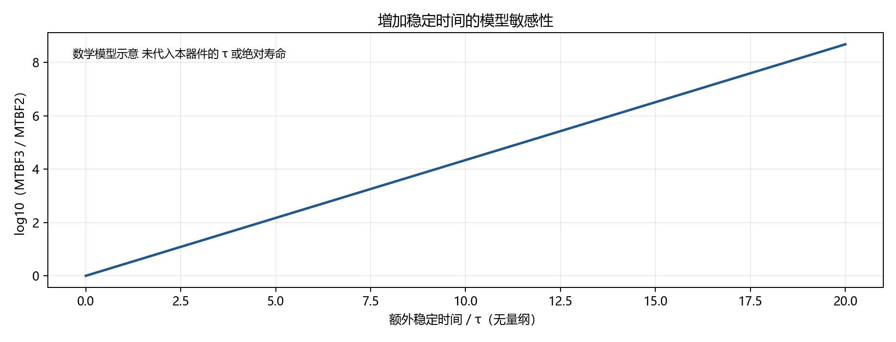

# 两级与三级同步的 MTBF 相对分析

采用常见模型 MTBF ≈ exp(Tres/τ)/(C·fclk·ftoggle)。Tres为可用稳定时间，C和τ依赖器件、PVT及模型定义，不能跨器件套用。方法来源：[TI SCZA004A](https://www.ti.com/lit/an/scza004a/scza004a.pdf)、[Ginosar 2011教程](https://webee.technion.ac.il/~ran/papers/MetastabilitySynchronizersTutorialIEEEDT2011.pdf)。

在同器件、相同频率和活动条件下，相对关系为 MTBF3/MTBF2 ≈ exp(ΔTres/τ)。新增一级带来接近一个目标域周期的稳定时间，但必须扣除单元、布线、setup和不确定度等开销。不能直接将一个整周期当作实测稳定时间。

| 同步方向 | 参考目标周期 ns | 额外等待的行为影响 |
| --- | ---: | --- |
| A读指针→写域 | 20 | full撤销多一个写周期 |
| A写指针→读域 | 12 | 首项可读多一个读周期 |
| B读指针→写域 | 35 | full撤销多一个写周期 |
| B写指针→读域 | 10 | 首项可读多一个读周期 |

曲线纵轴为log10的相对比值，横轴为ΔTres/τ，只展示数学敏感性，不是PH1A100寿命预测。本机资料未提供校准的C和τ，所以没有绝对MTBF年数。系统多个链的失效率还需汇总；单链MTBF不代表系统MTBF。

原始综合与实现均显示多44位寄存器，其中指针36位、请求/确认8位；原生行为测量显示首项读接受增加一个读周期、满撤销增加一个写周期。详见[实现资源](../implementation/REPORT.md)、[性能实测](../performance/REPORT.md)。长窗口稳态吞吐由供数或可用读带宽限制，两种级数相同的吞吐不表示延迟相同。

RTL及原生覆盖率测试验证逻辑行为，不能测量模拟亚稳态失效；最大数据路径约束检查也不等同器件可靠性签核。当前完整IO时序和ERAM复位警告尚未解决，功耗缺少模型，均单独保留。
